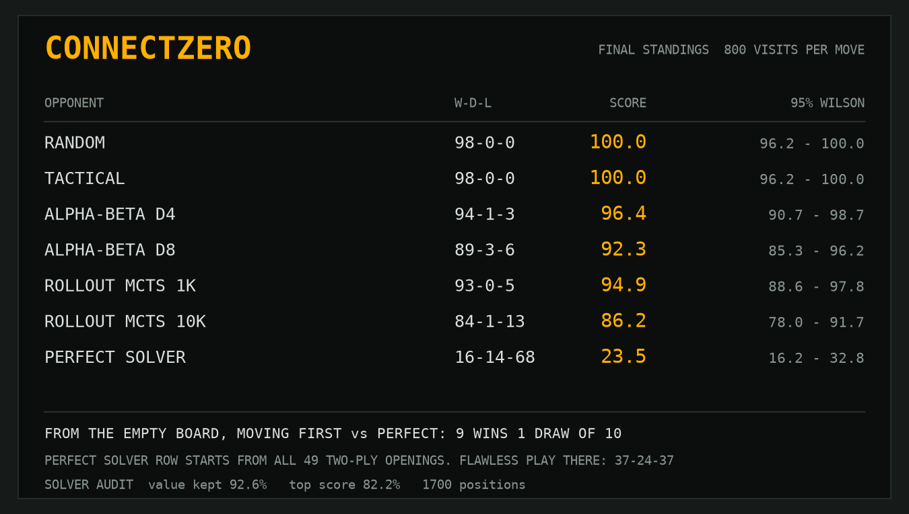
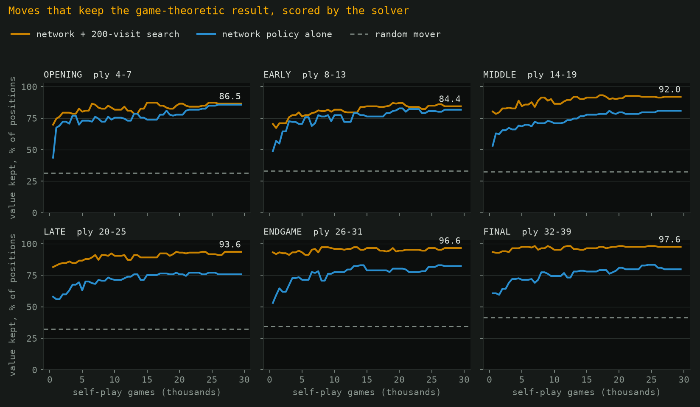
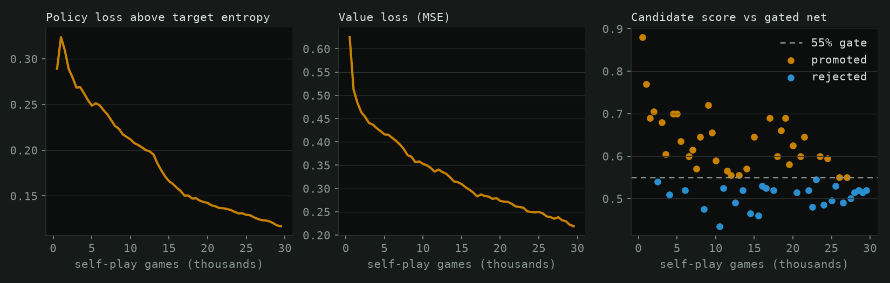
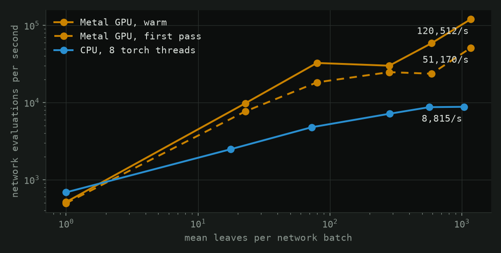
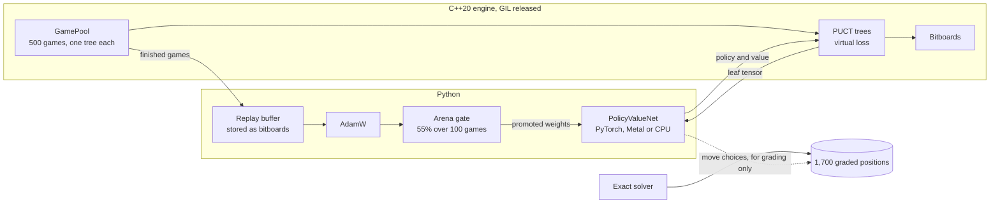
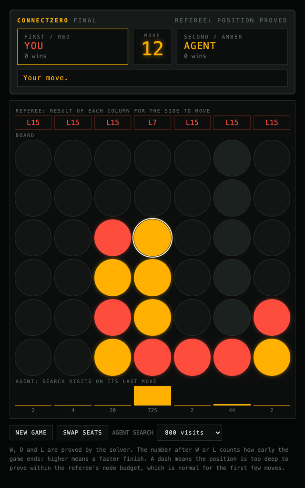

# connectzero

[](https://github.com/matejpopovski/connectzero/actions/workflows/ci.yml)

AlphaZero for Connect 4, with the marking done by a perfect solver.

Most AlphaZero projects can only report that they beat a weaker bot. Connect 4 is solved, so
here every move can be checked against the truth: a C++20 alpha-beta solver proves the exact
value of each column, and the agent is graded on 1,700 stratified positions as it learns.



Starting from the rules alone, 42 minutes of self-play on an Apple M3 Max (29,500 games) produced
a network that, moving first from the empty board at 800 visits per move, took 9 wins and 1 draw
from 10 games against the perfect solver. A win against a perfect opponent proves the network
never gave back the forced win, which takes 41 plies here. As second player it lost all 10, which
is the correct result for any player.

That headline flatters it, and the same scoreboard shows why. Started from all 49 two-ply openings,
including ones it would never choose, it went 16-14-68 where flawless play scores 37-24-37. It
keeps the game-theoretic result on 92.6% of contested benchmark positions at 800 visits and 94.4%
at 3,200. Depth-8 alpha-beta manages 89.9%, yet beats the network on the stricter top-score grade.

## The referee

Everything above rests on the solver, so it had to earn that position before grading anything.

| Check | Result | Source |
| --- | --- | --- |
| Empty board, each first move | `-2 -1 0 1 0 -1 -2`: centre wins, its neighbours draw, the rest lose, matching the published solution (Allis, 1988) | `results/solver_opening.json` |
| Tromp's 8-ply database (third party) | 67,557 of 67,557 positions agree, 0 mismatches | `results/solver_tromp.json` |
| Position counts, plies 0 to 8 (OEIS A212693) | exact match | `tests/test_board.py` |
| Brute-force minimax on late positions | exact score match, per move and per position | `tests/test_solver.py` |

The Tromp check earned its keep. A first pass reported 100 mismatches in 2,000 rows, all of them
correct wins returned as an unclamped fail-soft bound of `+16` instead of `+1`. The game values
were right and the API was wrong, and a self-consistency test would not have noticed. The fixed
solver went through the whole database clean.

From the empty board the solver visits 1,205,110,184 nodes in 101.8 s on one thread, about 11.8M
nodes per second, with a 512 MB table.

A score here follows the convention of Pons' tutorial: 0 is a draw, and +n means the side to move
wins with n - 1 of its own stones to spare, so bigger means sooner.

## Report card

The benchmark (`data/benchmark.csv`) has 1,700 positions across six game phases, balanced across
win, draw and loss where the candidates allow it, and every position has at least one column that
scores worse than the best. Moves are graded two ways.

**Value kept** asks whether the move preserves the game-theoretic result. It is counted on the 946
positions the side to move does not lose and where a wrong move exists. **Top score** asks whether
the move has the solver's best score, which also demands the fastest win or longest resistance,
over all 1,700 positions.

| Player | Value kept | Top score |
| --- | ---: | ---: |
| Random mover (exact expectation) | 34.4% | 27.1% |
| Tactical (win, block, otherwise random) | 62.9% | 61.7% |
| **Network policy, no search** | **80.9%** | **69.5%** |
| Rollout MCTS, 1,000 simulations | 86.6% | 80.4% |
| Alpha-beta, depth 4 | 86.6% | 83.5% |
| **Network + 50 visits** | **88.4%** | **78.5%** |
| Rollout MCTS, 10,000 simulations | 88.5% | 83.5% |
| Alpha-beta, depth 8 | 89.9% | 88.2% |
| **Network + 200 visits** | **91.8%** | **82.4%** |
| **Network + 800 visits** | **92.6%** | **82.2%** |
| **Network + 3,200 visits** | **94.4%** | **83.6%** |

The split by phase is where the two approaches separate. The network understands the opening far
better than a fixed search does, and the fixed search is cleaner once the horizon reaches the end
of the game.

| Value kept | Opening 4-7 | Early 8-13 | Middle 14-19 | Late 20-25 | Endgame 26-31 | Final 32-39 |
| --- | ---: | ---: | ---: | ---: | ---: | ---: |
| Positions counted | 126 | 186 | 162 | 157 | 147 | 168 |
| Random mover | 31.6% | 33.1% | 32.5% | 32.5% | 34.5% | 41.3% |
| Network policy alone | 85.7% | 81.7% | 80.9% | 75.8% | 82.3% | 79.8% |
| Network + 800 visits | 88.9% | 87.1% | 91.4% | 93.6% | 95.9% | 98.8% |
| Network + 3,200 visits | 92.1% | 88.2% | 93.2% | 95.5% | 98.6% | 99.4% |
| Alpha-beta, depth 8 | 77.8% | 79.6% | 88.9% | 95.5% | 96.6% | 100.0% |

Over training, on the gated network:



Matches use all 49 two-ply openings, each played with colours swapped, for 98 games per pairing.
Win-draw-loss for the network:

| Opponent | 200 visits | 800 visits |
| --- | ---: | ---: |
| Random | 98-0-0 | 98-0-0 |
| Tactical | 97-1-0 | 98-0-0 |
| Alpha-beta, depth 4 | 90-4-4 | 94-1-3 |
| Alpha-beta, depth 8 | 80-5-13 | 89-3-6 |
| Rollout MCTS, 1,000 | 87-0-11 | 93-0-5 |
| Rollout MCTS, 10,000 | 70-2-26 | 84-1-13 |
| Perfect solver | 15-13-70 | 16-14-68 |

Flawless play against the perfect seat from these openings scores 37-24-37, because 37 openings
are decided and 12 are drawn (`results/perfect_ceiling.json`). From the empty board the network
went 7-3-10 at 200 visits and 9-1-10 at 800, with all wins as first player
(`results/tournament.json`). Its first move at 800 visits gave 796 of 799 child visits to the
centre.

Reproduce with the commands in [Reproduce](#reproduce). Grades are in `results/final_grades.json`.

## What the run showed



**Search value flattened well before the run ended.** It reached 91.8% at 20,000 games and was
91.8% at 29,500, while the raw policy still crept from 79.7% to 80.9% (`results/run_analysis.json`).
The schedule also decays the learning rate by time spent, so this run cannot separate a true
plateau from a learning rate that had run out.

**Self-play found the first-player advantage on its own.** First-player score in self-play rose
from 0.55 in generation 1 to 0.88 in generation 59.

**The arena did little.** Of 59 candidates, 33 passed the 55% gate. Each of the 26 rejected
candidates was graded too, and on search value they averaged 0.14 points below the gated net, with
a spread of 0.49, and were better 23% of the time. Their raw policies averaged 0.51 points above it.
The gate caught no disasters, and from generation 55 on it rejected everything at scores of 0.50
to 0.52, which is a coin flip at 100 games. It cost 7.0 of the 42.1 minutes.

**The strict grade barely responds to search.** Top score stays near 82% to 84% from 200 to 3,200
visits while value kept climbs. That follows from the training target: the value head learns who
wins and not how soon, so search has no reason to prefer the faster of two wins. Depth-8 alpha-beta
has that preference built in, which is why it leads this column.

## Limitations

- **It is not close to perfect.** 16-14-68 against a 37-24-37 ceiling means it often cannot hold or
  convert positions outside its own lines. The first-player result covers the lines it plays.
- **The empty-board figure is 10 games.** The perfect seat only varies among equal-top-score moves,
  so these games explore a narrow set of lines. Treat 9 of 10 as evidence that those lines are
  sound, not a rate.
- **One seed, one run.** There is no variance estimate for any training result.
- **Draws are the weak spot.** Across all drawn positions, 89.1% of moves at 800 visits keep the
  draw, against 96.2% that keep a win. Early play is also weak: 88.2% at 3,200 visits for plies 8-13.
- **Benchmark positions come from semi-random play**, half tactical moves and half random, so they
  are not the positions strong players reach. Plies 0 to 3 are left out because solving them in
  bulk is expensive.
- **Self-play was shared.** Another project's job ran on this machine in 48 of 85 samples taken
  during training, so games-per-minute understates the hardware. Self-play ranged from 22,364 to
  81,388 evaluations per second, median 65,707 (`results/run_info.json`). That file was summarised
  after the run from the metrics log plus a load sampler that is not in this repo.
- **Throughput is one pass on a shared machine.** Treat differences under about 2x as noise.
- **Results are from macOS arm64.** CI only tests on Linux x86-64, and `std::gamma_distribution`
  differs between standard libraries, so the same seed gives different games across platforms.
- **Match intervals are approximate**, since the Wilson interval counts a draw as half a win.
- **The demo's referee has a budget.** It gives up after 30M nodes, about 3 seconds, so the first
  few moves show a dash instead of a proved result.

## Throughput



Measured with a freshly initialised 6-block, 64-filter network on an Apple M3 Max, 36 GB, at 100
visits per move (`results/throughput.json`).

Batching is the decision that matters. One leaf at a time reaches 514 evaluations per second on the
GPU, where latency dominates, and batches of about 1,170 reach 120,512. The CPU goes from 686 to
8,815.

The dashed line is a first pass over the same games. The Metal backend compiles a graph for each
new batch shape, and with leaf counts that vary every round that cost is large: 51,170 evaluations
per second cold against 120,512 warm. An earlier version of the benchmark mixed the two and
produced a misleading thread-scaling curve.

The C++ side is not the bottleneck. With a trivial evaluator it sustains 6.5M evaluations per
second on one thread, and adding threads makes it slower, down to 2.3M at eight, because each batch
is so cheap that thread start-up outweighs it. With the network in the loop, one search thread
reached 122,114 and eight reached 121,249. The training run used four and gained nothing from them.

Tree reuse, along with terminal nodes that need no network, saves a third of the work: a move at
100 visits costs 66.8 evaluations.

## How a batch moves



The solver appears on one side only. It writes the answer key, and nothing it computes reaches a
training target or a search during self-play, so the curves show what self-play learned on its own.

## Decisions and what was rejected

**Split search into `select` and `expand`.** A tree hands back a leaf and carries on, and the
evaluation arrives later, so 500 trees can share a batch. A design that evaluates each leaf as it is
reached is limited to about 514 evaluations per second here. An inference server thread was also
rejected: with one network and strict turns, a plain collect and apply loop has fewer moving parts.

**One table word per entry, with no locks.** A transposition slot is a single 64-bit word holding the
full key, bound and score, read and written with relaxed atomics. A reader sees a whole entry or a
mismatch, so threads can share the table freely, and a lost update only repeats some search.
Pons' solver packs partial keys and relies on a modulus argument. That saves memory, but a 64-bit
word makes correctness obvious and sharing trivial.

**Replay stores bitboards, not tensors.** Two words per position keep 400,000 positions cheap, and
the mirror image is drawn at sample time, so symmetry costs no storage.

**Grade on result as well as top score.** Top score alone would punish AlphaZero for a target it
never had. Result alone would ignore lost positions. Showing both is what exposed the gap with
alpha-beta.

**Every kept benchmark position has a wrong answer.** An early version screened candidates with a
result-only solve, which silently discarded every lost position past the opening, because all moves
in a lost position look equal under that screen. Exact solving past ply 8 turned out to be cheap, so
the screen went.

**Warm the solver table before perfect-seat matches.** A pool waits for every game each batch, so a
deep solve mid-match blocks the rest and runs on one worker. Solving the first plies in parallel
beforehand fixed that. The two perfect-seat matches still took 1,758 s and 2,094 s.

**Keep the arena for now.** The project was specified with gating, so it is here, but the run above
argues for dropping it, as AlphaZero itself did.

## Play it



The browser demo is a scoreboard around a live game. The solver scores every column as you play,
and the bars show where the agent's search went. In this capture from the running app, the referee
shows the human lost: six columns allow an immediate win, and the fourth only delays it.

```sh
uv run --frozen connectzero-demo
```

Then open http://127.0.0.1:45754. Everything runs locally on the CPU, and the trained weights in
`weights/connectzero.pt` (1.8 MB) are in the repo.

## Setup and tests

Needs [uv](https://docs.astral.sh/uv/), a C++20 compiler and CMake. `uv sync` builds the extension
from source. The default build uses no CPU-specific flags. Python 3.12 is pinned in
`.python-version`, and Linux installs CPU-only PyTorch from the lockfile.

```sh
uv sync --frozen
uv run --frozen pytest -m "not slow"   # 296 tests, under a minute
uv run --frozen pytest -m slow         # re-solves the opening from scratch, several minutes
```

The tests compare the bitboard rules with an independent grid implementation (`tests/reference.py`),
check the solver against brute-force minimax and a 60-row sample of Tromp's database, and pin the
search invariants: visit conservation, sign alternation, no residual virtual loss, subtree survival
on reroot, and identical games regardless of thread count. Encoding, replay mirroring, checkpoint
crash safety, resume, the watchdog and the demo's request logic are covered too.

## Reproduce

Commands run from the repo root on an Apple M3 Max. Use `--device cpu` without a Metal GPU, at a
lower game count.

```sh
# Answer key and solver checks
uv run --frozen python scripts/build_benchmark.py --per-stratum 300 --opening-quota 200 --threads 8 --log2-entries 26
uv run --frozen python scripts/solve_opening.py --log2-entries 26
sh scripts/download_tromp.sh
uv run --frozen python scripts/validate_tromp.py data/tromp/connect-4.data --threads 3 --chunk 2000 --log2-entries 25

# Training under a progress watchdog; resumes from atomic checkpoints in runs/main
uv run --frozen python -m connectzero.supervise --stall 420 -- --run runs/main --minutes 42 --device mps --torch-threads 2 --mcts-threads 4
cp runs/main/best.pt weights/connectzero.pt
cp runs/main/metrics.jsonl results/training_metrics.jsonl

# Grades, tournament, ceiling, throughput, figures
uv run --frozen python scripts/final_report.py --device mps --threads 4 --torch-threads 2 --only grades
uv run --frozen python scripts/final_report.py --device mps --threads 8 --torch-threads 2 --only tournament
uv run --frozen python scripts/final_report.py --only ceiling --threads 8
uv run --frozen python scripts/throughput.py --devices mps cpu
uv run --frozen python scripts/analyse_run.py
uv run --frozen python scripts/make_figures.py
```

The network has 6 residual blocks, 64 filters and 452,844 parameters. Training played 500 games per
generation at 200 visits, with Dirichlet noise and temperature for 12 plies, and 919,021 positions
went through 14,330 AdamW steps. Those settings came from one four-minute pilot, which is not in
`results/`.

## Credits

- John Tromp's [Connect-4 opening database](https://doi.org/10.24432/C59P43), CC BY 4.0, UCI Machine
  Learning Repository. A 60-row sample is in `tests/data`, and `scripts/download_tromp.sh` fetches
  the rest. Position counts are from [OEIS A212693](https://oeis.org/A212693), also by Tromp.
- The solver follows the techniques in Pascal Pons'
  [tutorial](http://blog.gamesolver.org/) in an independent implementation.
- Victor Allis, *A Knowledge-based Approach of Connect-Four*, 1988, for the solved first moves.
- Silver et al., *Mastering the game of Go without human knowledge*, 2017, and *A general
  reinforcement learning algorithm that masters chess, shogi, and Go through self-play*, 2018.

MIT licence.
